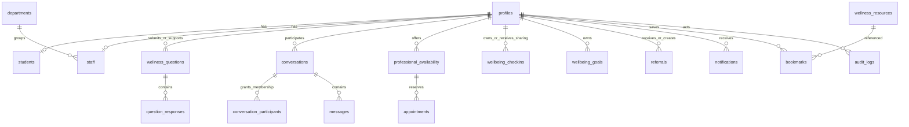

# Database relationships

All 23 application tables live in the private PostgreSQL `kira` schema. Primary keys are UUIDs; records have UTC `created_at` and `updated_at` timestamps. Supabase Auth user IDs become `profiles.id` after verified synchronization. The application does not store passwords. `profiles.role` is the single role assignment, constrained to student/staff/admin.

`wellness_resources` hold reviewed publication content; `daily_wellness_cards` hold the seven-card-compatible messages and publication dates. `wellness_categories`, `departments`, `emergency_contacts`, `platform_settings`, and `ai_knowledge_sources` are managed directories/content.

Appointments refer to an availability slot rather than duplicating times. A partial unique index permits at most one pending, confirmed, or rescheduled appointment per slot; cancellation preserves history and releases it for another request. Profile and slot locks serialize reservation checks in PostgreSQL. Slot creation also serializes overlapping availability checks per professional.

Conversation access checks ownership or assigned professional, in addition to participant tracking. Check-in sharing is an explicit `shared_with_id` relation; it never grants general access to all of a student’s records. Audit records contain action names and entity references, never the private text itself.

Initial migration: `alembic/versions/0001_kira.py`. It is a frozen schema revision with explicit tables, foreign keys, indexes and constraints. Future model changes require a new reviewed Alembic migration. Development SQLite uses SQLAlchemy’s schema translation; it is not a separate production schema.
